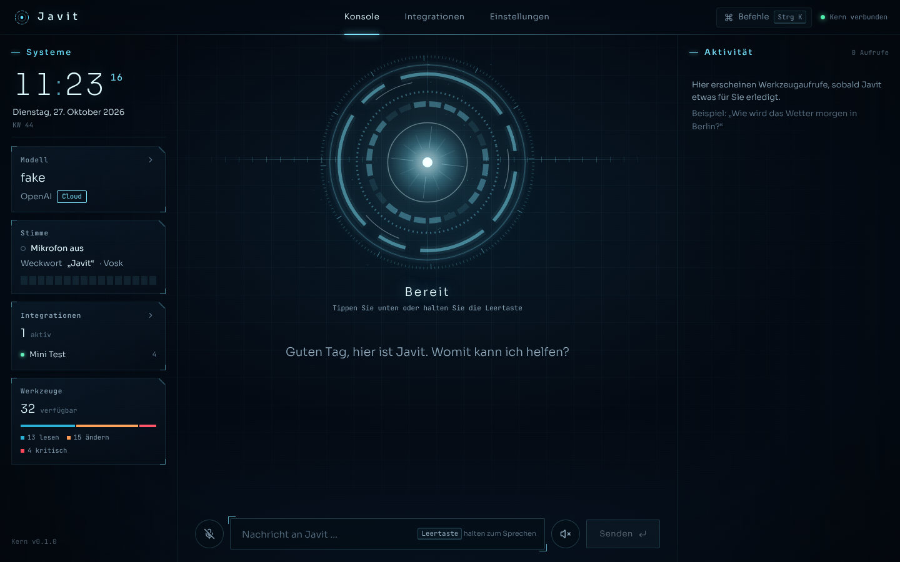

🇬🇧 **English** · 🇩🇪 [Deutsch](README.de.md)

# Javit – your personal AI assistant for Mac, Windows and Linux

Javit answers to **"Javit"** (name and wake word are freely configurable), understands German, gets things done on your
computer (apps, music, volume, clipboard, files, web – and on the Mac also Calendar, Reminders,
Notes and Shortcuts) and can be extended with more apps in seconds – via the catalog
("Javit, integrate Spotify"), MCP servers, OpenAPI or simple REST endpoints. Its brain is **any
language model**: local and offline via Ollama, or in the cloud (Claude, GPT, Gemini …). Critical
actions are only executed after your **approval**.

> The assistant speaks and understands **German**; the user interface, the voice pipeline and
> all built-in texts are in German. This page is the English overview.



```
"Javit" → wake word → speech recognition → agent (model + tools) → answer (text + speech)
                                               │
          system tools (Mac/Windows/Linux) · integrations (MCP/REST/OpenAPI) · memory · approvals
```

---

## Contents

1. [One-step installation](#one-step-installation) (macOS)
   · [Installation on Linux](#installation-on-linux)
   · [Installation on Windows](#installation-on-windows)
   · [Platform differences](#platform-differences)
2. [First start](#first-start)
3. ["Javit" – voice, name and wake word](#javit--voice-name-and-wake-word)
4. [Models](#models)
5. [Integrations](#integrations)
6. [Example phrases](#example-phrases)
7. [Security and approvals](#security-and-approvals)
8. [Data storage](#data-storage)
9. [Troubleshooting](#troubleshooting)
10. [Development and tests](#development-and-tests)
11. [Layout](#layout)

---

## One-step installation

**macOS** (see the following sections for Linux and Windows). Requirements: macOS (Apple Silicon
recommended), [Homebrew](https://brew.sh), about 8 GB of free disk space for the local model.

```bash
cd ~/Documents/jarvis && ./scripts/install.sh
```

The script

* checks for Homebrew (if missing, it shows the official install command and stops),
* installs `python@3.12`, `node` and `ollama` if needed,
* pulls the local language model `qwen2.5:7b` (about 4.7 GB) and `nomic-embed-text` for the memory –
  **the first download takes a few minutes depending on your connection**,
* creates the Python environment `~/.jarvis/venv` and installs the core with the voice module,
* builds the user interface (`npm ci && npm run build`),
* places the equivalent commands `javit` and `jarvis` in `~/.local/bin` (and adds them to `PATH`
  in `~/.zshrc` if needed),
* pre-downloads the wake-word models: the Vosk model `vosk-model-small-de-0.15` (about 45 MB) for
  "Javit" plus openWakeWord "Hey Jarvis".

Running it several times is safe (e.g. after an update). Options:
`JARVIS_OHNE_MODELLE=1` (skip the Ollama models), `JARVIS_MODELL=llama3.1:8b` (another local
model), `JARVIS_KEIN_PATH=1` (leave `~/.zshrc` untouched).

## Installation on Linux

Supported: Ubuntu/Debian, Fedora, Arch (including Manjaro/EndeavourOS) and openSUSE; GNOME, KDE and
other desktops; X11 and Wayland.

```bash
cd ~/jarvis && ./scripts/install-linux.sh               # with local model: JARVIS_OLLAMA=1 ./scripts/install-linux.sh
```

The script

* detects the package manager (apt, dnf, pacman, zypper) and installs via `sudo` (only for this):
  Python 3 with venv, Node.js/npm, PortAudio, `playerctl`, libnotify (`notify-send`),
  `wl-clipboard`/`xclip`, `pulseaudio-utils` (`pactl`) and `espeak-ng`,
* checks Node.js (requires 20.19+ or 22.12+); if it is too old, it points to
  [nvm](https://github.com/nvm-sh/nvm) or [NodeSource](https://github.com/nodesource/distributions) – it never
  installs anything behind the package manager's back,
* installs **Ollama only with `JARVIS_OLLAMA=1`** via the official script (`ollama.com/install.sh`),
  otherwise it prints a hint; with Ollama, `qwen2.5:7b` and `nomic-embed-text` are pulled,
* creates `~/.jarvis/venv` (on problems or with an old Python via `uv` with its own Python 3.12),
  installs the core with the voice module (including Piper) and builds the user interface,
* creates `~/.local/bin/javit` and `~/.local/bin/jarvis` as well as the start-menu entry "Javit"
  (`~/.local/share/applications/jarvis.desktop`) and downloads the wake-word models (Vosk for "Javit").

Options as on the Mac: `JARVIS_OHNE_MODELLE=1`, `JARVIS_MODELL=…`, `JARVIS_KEIN_PATH=1`, plus
`JARVIS_OHNE_PAKETE=1` (no system packages, no sudo). Autostart as a systemd user service:

```bash
./scripts/autostart-linux.sh an | aus | status      # ~/.config/systemd/user/jarvis.service
```

Notes: speech output uses **Piper** with the voice `de_DE-thorsten-medium` (downloaded to
`~/.jarvis/modelle/piper` on first use, about 60 MB), otherwise `espeak-ng`. The microphone runs via
PipeWire/PulseAudio (choose the input device in the sound settings or with `pavucontrol`). On
Wayland there is no general window list – `laufende_apps` then matches running processes against
installed apps. API keys go into the Secret Service (GNOME Keyring/KWallet), or into the encrypted
file when no such service is running.

## Installation on Windows

Windows 10 (1809 or later) or 11 with `winget` (App Installer). In PowerShell inside the project folder:

```powershell
powershell -ExecutionPolicy Bypass -File scripts\install-windows.ps1          # without Ollama: … -OhneOllama
```

`-ExecutionPolicy Bypass` only applies to this single call – the system setting stays unchanged.
The script

* installs via winget if needed: **Python 3.12** (`Python.Python.3.12`), **Node.js LTS**
  (`OpenJS.NodeJS.LTS`) and **Ollama** (`Ollama.Ollama`, disable with `-OhneOllama`) and pulls the
  local models (`-OhneModelle` skips this, `-Modell llama3.1:8b` picks another one),
* creates `%USERPROFILE%\.jarvis\venv` (fallback: `uv`), installs the core with the voice module and
  builds the user interface,
* places `javit.cmd` and `jarvis.cmd` in `%USERPROFILE%\.jarvis\bin`, extends the **user PATH**
  (`-KeinPath` prevents this), creates a **start-menu shortcut** "Javit" and downloads the
  wake-word models (Vosk for "Javit").

Start: `javit start` in a new terminal, via the start menu or by double-clicking
`scripts\start-windows.cmd`. Autostart at login (Task Scheduler, no console window):

```powershell
powershell -ExecutionPolicy Bypass -File scripts\autostart-windows.ps1 -An    # or -Aus / -Status
```

Notes: allow microphone access under Settings → Privacy & security → Microphone (including
"Let desktop apps access your microphone"). Speech output uses the Windows voices (SAPI); if no
German voice is installed: Settings → Time & language → Language → German → Speech.
API keys go into the Windows Credential Manager. Notifications appear as toasts (via the
PowerShell module BurntToast if installed).

## Platform differences

| Feature | macOS | Windows | Linux |
|---|---|---|---|
| Open/quit apps, running apps | AppleScript, `open` | start-menu/Store apps, `CloseMainWindow` | desktop files (`gtk-launch`), `pkill`; window list via `wmctrl` (X11) |
| Volume | AppleScript | Core Audio (COM), fallback media keys | `wpctl` / `pactl` / `amixer` |
| Music | Apple Music and Spotify (including library search) | media keys, title from the Spotify window | `playerctl` (Spotify and all MPRIS players) |
| Notifications | Notification Center | toast (BurntToast or WinRT) | `notify-send` |
| Clipboard, screenshot | `pbcopy`, `screencapture` | `Get/Set-Clipboard`, System.Drawing | `wl-copy`/`xclip`/`xsel`; `gnome-screenshot`/`spectacle`/`grim`/`scrot` |
| File search | Spotlight (including contents) | Windows Search index (including contents), otherwise by name | `plocate`/`locate`, otherwise by name |
| Trash | Finder | Recycle Bin (send2trash) | freedesktop trash (send2trash) |
| Shell tool | zsh | Windows PowerShell | bash |
| **Reminders, Calendar, Notes** | ✓ (Apple apps) | – → integrations `google-kalender`, `todoist`, `notion`, `obsidian` | – → the same integrations |
| **Apple Shortcuts** | ✓ | – (Home Assistant or similar as an integration) | – |
| Speech output (local) | `say` | SAPI (e.g. Microsoft Hedda) | Piper, fallback espeak-ng |
| API keys | Keychain | Credential Manager | Secret Service (keyring) |
| Autostart | `scripts/autostart.sh` (launchd) | `scripts/autostart-windows.ps1` (Task Scheduler) | `scripts/autostart-linux.sh` (systemd --user) |

Tool names and risk levels are the same everywhere; Mac-only tools are not offered on
Windows/Linux at all – instead Javit suggests matching catalog integrations.

## First start

```bash
javit start             # starts the server on http://127.0.0.1:8765 and opens the browser
                        # ("jarvis start" works the same way)
```

Alternatively: double-click `scripts/start.command` in Finder. Start automatically at every login:

```bash
./scripts/autostart.sh an      # launchd service de.jarvis.agent (identifier kept for existing autostarts)
./scripts/autostart.sh aus
./scripts/autostart.sh status
```

macOS asks for permissions on first access – please allow:

* **Microphone** (for the wake word "Javit"): System Settings → Privacy & Security → Microphone →
  Terminal (or your terminal app; with autostart "python3.12").
* **Automation** (Music, Calendar, Reminders, Notes, Finder): Privacy & Security → Automation.

## "Javit" – voice, name and wake word

* The microphone button in the UI (or `Ctrl/⌘ + K` → "Mikrofon") toggles the wake word on/off.
* Then **"Javit, …"** is enough – Javit listens until you pause and answers by voice.
* **Space bar** (outside input fields) = push-to-talk: listen once without the wake word.
* Speech recognition runs locally with faster-whisper (model downloaded on first use) or in the
  cloud; speech output "Automatisch" (macOS `say`, Windows SAPI, Linux Piper/espeak-ng) or cloud
  voices – all under **Einstellungen → Stimme** (Settings → Voice).
* Approvals can be answered by voice ("Ja", "Mach das" / "Nein", "Abbrechen").

### Changing the name

**Einstellungen → Persona → Name des Assistenten** (or `"name": "…"` in
`~/.jarvis/einstellungen.json`). The name appears in the header, window title, boot animation,
approval dialog, announcements and error messages and is inserted into the persona (system
prompt) via the placeholder `{name}`. Older settings files with the former default persona
("Du bist Jarvis …") automatically receive the new default persona; a hand-written persona stays
unchanged (only `{name}` is applied there). The wake word is configured **separately** (see below).
Internal identifiers stay the same: Python package `jarvis`, folder `~/.jarvis`, environment
variables `JARVIS_*`, command `jarvis` (plus `javit`).

### Wake word and engines

**Einstellungen → Stimme → Weckwort** (text, several separated by commas, e.g. `javit, hey javit`) and
**Weckwort-Erkennung** (wake-word engine):

| Engine | When | Properties |
|---|---|---|
| **Vosk** (default for "Javit") | any free word | offline, no training; small German model `vosk-model-small-de-0.15` (~45 MB, downloaded to `~/.jarvis/modelle/vosk` when first enabled) |
| **openWakeWord** | `hey_jarvis` or your own `.onnx` model | very lightweight; ready-made models only for English phrases |
| **Automatic** (`auto`) | – | `hey_jarvis`/"hey jarvis" (and other ready-made openWakeWord words) or a custom model → openWakeWord, everything else → Vosk |

How Vosk recognizes "Javit" although the word is not in the model's vocabulary: Vosk ignores
unknown words of a grammar. Javit therefore builds a small grammar from **known
syllables/words** ("ja witt", "ja vit", "jawit", "javid", "dschawit" … – only what
`Model.find_word()` finds in the vocabulary) plus similar-sounding everyday words ("ja", "bitte",
"mit", "david" …) and `[unk]`. The (partial) result is then compared **phonetically**: merged words
("ja witt" → "jawitt") with the same **Cologne phonetics** code (032) and a similar spelling
(Levenshtein) count as hits – exact variants immediately, phonetic ones only when they appear in
two consecutive partial results. Custom spellings: `"weckwort_varianten": ["ja witt", "dschawit"]`
under `stimme` (replaces the default list). The **wake-word sensitivity** (`schwelle`) applies to
both engines: with Vosk 0.5 = exact or phonetically identical hits, 0.9 = only very similar
spellings, lower = fuzzy hits too.

Pre-download or test: `~/.jarvis/venv/bin/python -m jarvis.stimme --modelle-laden --alle` or
`python -m jarvis.stimme --weckwort javit` (echo test). Without internet on first start: download
the model from alphacephei.com/vosk/models and unpack it to
`~/.jarvis/modelle/vosk/vosk-model-small-de-0.15/` (or set `"vosk_modell": "/path/to/model"`).

### Training your own wake-word model (optional)

For an especially lightweight, robust wake word you can train an openWakeWord model "javit" with the
official training notebook (synthetic data, Google Colab):
[scripts/weckwort-trainieren.md](scripts/weckwort-trainieren.md). The `.onnx` file goes to
`~/.jarvis/modelle/openwakeword/` and is loaded via `"weckwort_modell_pfad"`
(`python3 scripts/weckwort_trainieren.py installieren javit.onnx` does both).

## Models

The default is the local model `ollama/qwen2.5:7b` – runs completely offline. Other local models
with reliable tool calling: `qwen3:8b`, `llama3.1:8b`, `llama3.2:3b` (`ollama pull <name>`).

```bash
javit modell                               # list all models (Ollama live + cloud suggestions)
javit modell ollama/qwen3:8b               # switch (applies from the next request)
```

Cloud models (LiteLLM notation) need an API key, which is stored in the **macOS Keychain**
(Windows: Credential Manager, Linux: Secret Service). In the UI under **Einstellungen → Modell** you
pick the **provider** at the top, enter its key right below and get the **model list live from the
provider** (without a key: a fixed list of suggestions). Free models are marked "kostenlos".

| Provider | Key | Example model IDs |
|---|---|---|
| Anthropic | `ANTHROPIC_API_KEY` | `anthropic/claude-sonnet-5-5`, `anthropic/claude-opus-5-5` |
| OpenAI | `OPENAI_API_KEY` | `openai/gpt-6.1-sol`, `openai/gpt-5.4-mini` |
| Google Gemini | `GEMINI_API_KEY` | `gemini/gemini-4-argon`, `gemini/gemini-3.8-flash` (free tier) |
| OpenRouter | `OPENROUTER_API_KEY` | `openrouter/deepseek/deepseek-v4.1-flash`, `openrouter/moonshotai/kimi-k3`, `openrouter/z-ai/glm-5.3-flash`; **free models** end in `:free` |
| DeepSeek | `DEEPSEEK_API_KEY` | `deepseek/deepseek-flash`, `deepseek/deepseek-v4-pro` |
| Kimi (Moonshot) | `MOONSHOT_API_KEY` | `moonshot/kimi-k3` |
| GLM (Z.AI) | `ZAI_API_KEY` | `zai/glm-5.3`, `zai/glm-5.3-flash` |
| OpenCode | `OPENCODE_API_KEY` | `opencode/kimi-k2.5`, `opencode/glm-5.3-flash` – **paid** models only (OpenCode's free models only work inside OpenCode itself, per its docs) |
| Groq, Mistral, xAI | `GROQ_API_KEY`, `MISTRAL_API_KEY`, `XAI_API_KEY` | `groq/llama-3.3-70b-versatile`, `mistral/mistral-large-latest`, `xai/grok-4.7` |

Keys from the terminal: `javit schluessel OPENROUTER_API_KEY` (hidden input). Models can also be
switched by voice ("Wechsle auf Claude Sonnet"). **Your own OpenAI-compatible providers** (LM Studio,
vLLM, a proxy …) are added in the UI via "Anbieter hinzufügen" (name, base URL, optional key) and
appear as their own provider with model IDs `<id>/<model>` (`einstellungen.json`: `anbieter_eigene`).
Alternatively `api_basen` per model ID still works, e.g. `{"openai/mein-modell": "http://127.0.0.1:1234/v1"}`.

## Integrations

**From the catalog** (`integrationen/katalog/*.yaml`, 22 entries: Spotify, GitHub, Notion, Slack,
Gmail, Google Calendar, Todoist, Obsidian, Home Assistant, Philips Hue, weather, browser, …):

```bash
javit katalog              # all entries
javit katalog musik        # search
javit add spotify          # asks for missing values (client ID/secret)
javit list                 # installed integrations and status
javit remove spotify
```

**By voice or chat:** "Javit, integriere Notion." – Javit searches the catalog, asks for missing
keys and creates the integration after your approval.

**In the UI:** Integrationen → Katalog or → Eigene (custom).

**Custom integrations:**

```bash
javit add "npx -y @modelcontextprotocol/server-everything"        # MCP server (stdio)
javit add https://homeassistant.local:8123/api/mcp                # MCP over HTTP
javit add https://petstore3.swagger.io/api/v3/openapi.json        # OpenAPI → tools
```

Simple REST endpoints and headers/authentication can be set up in the UI ("Eigene" → REST).
Custom catalog entries: YAML file in `~/.jarvis/katalog/` (format: [docs/VERTRAEGE.md](docs/VERTRAEGE.md)).

**Browser:** `javit add browser` adds the Playwright MCP server – Javit can then open web pages in a
real browser, click and fill in forms. If the browser is missing: `npx playwright install chromium`.

## Example phrases

(The assistant understands German; these are the German phrases with translations.)

* „Javit, wie spät ist es?“ (what time is it?) · „Was steht heute in meinem Kalender?“ (what's on my calendar today?)
* „Spiel etwas Jazz auf Spotify.“ (play some jazz on Spotify) · „Lauter.“ (louder) · „Nächstes Lied.“ (next track)
* „Erinnere mich morgen um 9 an den Zahnarzt.“ (remind me of the dentist tomorrow at 9) · „Stell einen Timer auf zehn Minuten.“ (set a ten-minute timer)
* „Leg eine Notiz ‚Einkauf: Milch, Brot‘ an.“ (create a note "shopping: milk, bread")
* „Merk dir, dass ich Earl Grey ohne Zucker trinke.“ (remember that I drink Earl Grey without sugar)
* „Such die PDF mit der Steuererklärung und öffne den Ordner.“ (find the tax-return PDF and open its folder)
* „Fasse diese Webseite zusammen: https://…“ (summarize this web page) · „Suche im Web nach …“ (search the web for …)
* „Führe den Kurzbefehl ‚Licht aus‘ aus.“ (run the shortcut "lights off") – with approval
* „Integriere GitHub.“ (integrate GitHub) · „Welche Integrationen sind verbunden?“ (which integrations are connected?)

## Security and approvals

* Every tool has a risk level: **read**, **change**, **critical**. Critical actions (shell,
  deleting, sending, paying, installing, Shortcuts, overwriting files, writing into autostart or
  configuration folders – macOS `~/Library`, Windows `AppData` including the Startup folder plus
  `.exe/.bat/.ps1/.reg/.lnk`, Linux `~/.config/autostart`, `~/.config/systemd/user`, `~/.bashrc`/`.profile`,
  `~/bin`, crontab – and reading key files) show an **approval dialog** –
  without an answer the request counts as "denied" after 120 s.
* Content returned by tools (web pages, mails, files) is treated as data, not as instructions; it
  cannot grant an approval.
* The server listens **only on 127.0.0.1**. Foreign web pages can use neither the API nor the
  WebSocket (origin check, also in the WebSocket handshake; host check against DNS rebinding).
* API keys live in the **macOS Keychain** (service `jarvis`; Windows/Linux: via `keyring` in the
  Credential Manager or the Secret Service) and are never passed as process arguments; secret values
  are redacted in events sent to the UI.
* `Esc` aborts the running answer and denies open approvals.

## Data storage

Everything lives in `~/.jarvis/` (Windows: `%USERPROFILE%\.jarvis`, relocatable with `JARVIS_HOME`):

| Path | Content |
|---|---|
| `einstellungen.json` | name, model, persona, form of address, voice/wake word, timeouts … |
| `integrationen.json` | installed integrations (secrets only as `${NAME}`) |
| `jarvis.db` | history and memories (SQLite) |
| `logs/` | logs (`mcp-<id>.log`, `jarvis.log` with autostart) |
| `modelle/` | wake-word models (`modelle/vosk`, `modelle/openwakeword`), on Linux also Piper voices (`modelle/piper`) |
| `venv/` | Python environment of the installation |

The memory can be cleared in the UI (Einstellungen → Gedächtnis); history and memory also via
`curl -X DELETE http://127.0.0.1:8765/api/verlauf` or `…/api/gedaechtnis`.

## Troubleshooting

| Problem | Solution |
|---|---|
| `javit: command not found` | open a new terminal or run the installer again (creates `javit`), or `source ~/.zshrc` (Linux: `~/.bashrc`); as a last resort `~/.jarvis/venv/bin/jarvis start` (Windows: `%USERPROFILE%\.jarvis\venv\Scripts\jarvis.exe start`) |
| Linux: "Für … fehlt ein Hilfsprogramm" (helper program missing) | run the install command shown (e.g. `sudo apt install playerctl`) |
| Windows: script "cannot be loaded" | start with `powershell -ExecutionPolicy Bypass -File …` |
| "Ollama ist nicht erreichbar" (Ollama unreachable) | `brew services start ollama` (or `ollama serve`), then `ollama pull qwen2.5:7b` |
| Model answers without tools | choose a tool-capable model (`qwen2.5`, `qwen3`, `llama3.1`, `llama3.2`) |
| "API-Schlüssel fehlt" (API key missing) | `javit schluessel ANTHROPIC_API_KEY` (or OPENAI/GEMINI), no server restart needed |
| "Javit" does not react | check microphone permission; Einstellungen → Stimme → lower the sensitivity; custom spellings (`weckwort_varianten`); `python -m jarvis.stimme --geraete` |
| "Vosk-Modell … fehlt" (Vosk model missing) | internet connection when first enabling, or unpack the model manually (see above); `pip install vosk` (part of `jarvis[stimme]`) |
| Wake word triggers too often | raise the sensitivity (e.g. 0.7–0.9) or train your own openWakeWord model |
| Music/Calendar refused | Privacy & Security → Automation: allow Terminal/Python |
| Integration "fehler" (error) | check the status under Integrationen, log `~/.jarvis/logs/mcp-<id>.log`, "Neu verbinden" (reconnect) |
| Port 8765 in use | `javit start --port 8766` |
| UI missing ("nicht gebaut") | `cd oberflaeche && npm ci && npm run build` |

## Development and tests

```bash
# core
cd kern && python3 -m pip install -e '.[stimme,dev]'
python3 -m pytest -q                      # unit and end-to-end tests (offline)

# user interface
cd oberflaeche && npm ci
npm run dev                               # Vite on :5173, proxy to the core on :8765
npm run typecheck && npm test && npm run build

# browser run (Playwright, screenshots to /tmp/jarvis-e2e)
cd kern && python3 -m tests.e2e.browser_durchlauf
```

The end-to-end tests (`kern/tests/e2e/`) start a real server with a deterministic,
OpenAI-compatible fake LLM (`openai/fake`) and add the project's own mini MCP server as an
integration. Notes for contributions with Claude: [CLAUDE.md](CLAUDE.md);
project status: [docs/STAND.md](docs/STAND.md).

## Layout

```
jarvis/
├── kern/                     Python package "jarvis" (FastAPI, agent, LiteLLM, tools, MCP hub, CLI)
│   ├── jarvis/plattform/     platform layer (macOS, Windows, Linux)
│   ├── jarvis/stimme/        wake word (Vosk/openWakeWord), recording, speech recognition, speech output
│   └── tests/                pytest (including e2e/ with fake LLM and browser run)
├── oberflaeche/              React + TypeScript + Vite (served under /)
├── integrationen/katalog/    integration catalog (one YAML file per app)
├── scripts/                  install.sh/autostart.sh/start.command (macOS), install-linux.sh/autostart-linux.sh,
│                             weckwort-trainieren.md + weckwort_trainieren.py (custom wake-word model),
│                             install-windows.ps1/autostart-windows.ps1/start-windows.cmd
└── docs/                     ARCHITEKTUR.md, VERTRAEGE.md (binding interfaces), STAND.md
```

Architecture and interfaces: [docs/ARCHITEKTUR.md](docs/ARCHITEKTUR.md),
[docs/VERTRAEGE.md](docs/VERTRAEGE.md), core details: [kern/README.md](kern/README.md).
