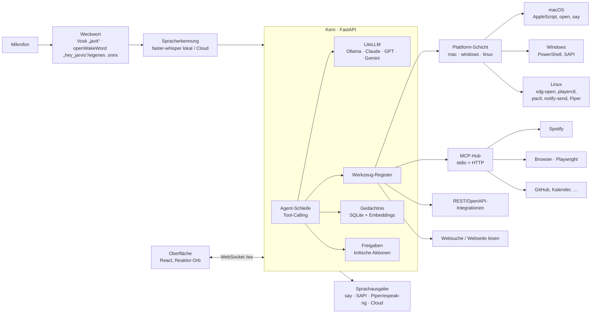

# Javit – Architektur (Projekt/Paket „jarvis“)

Persönlicher KI-Assistent für macOS, Windows und Linux: hört auf **„Javit“** (Name und Weckwort einstellbar), nutzt **beliebige Modelle**
(lokal über Ollama oder Cloud: Claude, GPT, Gemini, … über LiteLLM), erledigt Aufgaben mit
**Werkzeugen**, und neue Apps lassen sich **in Sekunden integrieren** – per MCP-Server, REST/OpenAPI
oder aus einem fertigen Katalog (z. B. „Spotify hinzufügen“).



## Bausteine

| Ordner | Inhalt |
|---|---|
| `kern/` | Python-Paket `jarvis`: FastAPI-Server, Agent, LLM-Fassade, Werkzeuge, MCP-Hub, Integrationen, Gedächtnis, Konfiguration, CLI |
| `stimme/` | Teil des Pakets `jarvis.stimme`: Weckwort (`weckwort.py` openWakeWord + Engine-Auswahl, `weckwort_vosk.py` freies Weckwort), Aufnahme mit Sprachpausen-Erkennung, STT, TTS |
| `oberflaeche/` | React + TypeScript + Vite, futuristische HUD-Oberfläche (Name aus `/api/status`), wird vom Kern unter `/` ausgeliefert |
| `integrationen/katalog/` | YAML-Dateien des Integrationskatalogs (eine Datei = eine App) |
| `kern/jarvis/plattform/` | Plattform-Schicht: Erkennung (`aktuelle_plattform()`) und Systemaktionen je Betriebssystem (siehe unten) |
| `scripts/` | macOS: `install.sh`, `autostart.sh` (launchd `de.jarvis.agent`), `start.command`; Linux: `install-linux.sh`, `autostart-linux.sh` (systemd --user); Windows: `install-windows.ps1`, `autostart-windows.ps1` (Aufgabenplanung), `start-windows.cmd` |

## Grundsätze

1. **Modellunabhängig** – alle Modellaufrufe nur über `jarvis/llm.py` (LiteLLM). Modell im UI umschaltbar.
2. **Integration in einem Schritt** – `jarvis add spotify`, im UI „Integration hinzufügen“, oder per Sprache
   („Javit, integriere Spotify“). Unterstützt: Katalogeintrag, beliebiger MCP-Befehl (`npx …`, `uvx …`),
   MCP-URL, OpenAPI-URL, einfache REST-Endpunkte.
3. **Sicherheit** – Werkzeuge haben eine Risikostufe (`lesen`, `aendern`, `kritisch`). Kritisch (Shell,
   Löschen, Senden, Bezahlen, Installieren) erfordert Freigabe per Klick oder „Ja“ per Sprache.
   Geheimnisse (API-Schlüssel) im macOS-Schlüsselbund, unter Windows/Linux über `keyring`
   (Anmeldeinformationsverwaltung bzw. Secret Service); Fallback: verschlüsselte Datei.
4. **Lokal zuerst** – läuft komplett offline mit Ollama + faster-whisper + `say` (Windows: SAPI,
   Linux: Piper/espeak-ng).
5. **Plattformneutral** – Werkzeuge haben überall dieselben Namen und Risikostufen; was ein
   Betriebssystem nicht kann, wird dort nicht angeboten (statt Fehlern zur Laufzeit).

## Plattform-Schicht

```
jarvis/plattform/__init__.py   aktuelle_plattform() → mac | windows | linux  (JARVIS_PLATTFORM überschreibt)
                               Systemaktionen (ABC) + systemaktionen(plattform)
jarvis/plattform/mac.py        MacAktionen – delegiert an die unveränderten Werkzeuge in werkzeuge/mac.py
jarvis/plattform/windows.py    WindowsAktionen – PowerShell 5.1 per -EncodedCommand
jarvis/plattform/linux.py      LinuxAktionen – Desktop-Dateien, gtk-launch, pkill, wpctl/pactl/amixer,
                               notify-send, playerctl, wl-clipboard/xclip/xsel, Screenshot-Tools, plocate
jarvis/plattform/gemeinsam.py  Installationshinweise je Distribution, Python-Dateisuche, Bilder-Ordner
jarvis/werkzeuge/desktop.py    plattformneutrale Werkzeuge (app_oeffnen … systeminfo) für Windows/Linux
```

* **Registrierung** (`anwendung.py` → `desktop.plattform_werkzeuge()`): Auf dem Mac werden wie bisher
  alle Werkzeuge aus `werkzeuge/mac.py` registriert, einschließlich der Mac-exklusiven
  (`erinnerung_anlegen`, `kalender_termine`, `termin_anlegen`, `notiz_anlegen`,
  `kurzbefehle_auflisten`, `shortcuts_ausfuehren`). Unter Windows/Linux kommen die neutralen
  Werkzeuge aus `desktop.py` mit gleichen Namen und Risikostufen; der Systemprompt verweist für
  Kalender/Erinnerungen/Notizen auf Katalog-Integrationen (`google-kalender`, `todoist`, `notion`, `obsidian`).
* **Sicherheit beim Programmaufruf**: Nie eine Shell (außer im kritischen `shell_befehl`). Windows:
  feste Skripttexte, Werte nur über Umgebungsvariablen `JARVIS_ARG_*` bzw. Base64 über stdin,
  Ausgabe Base64 (codepage-unabhängig). Linux: Argumentlisten, Werte hinter `--`, Texte über stdin.
  `app_oeffnen`/`app_beenden` nehmen nur App-Namen (keine Pfade/URLs) und lehnen Systemprogramme
  wie `reboot`, `logoff`, `systemctl`, `sudo` ab (`plattform.linux.GESPERRTE_PROGRAMME`), damit das
  freigabefreie „App öffnen“ weder beliebige Dateien noch Neustart/Abmelden auslöst.
* **Kritische Pfade** (`werkzeuge/dateien.py`): macOS unverändert; Windows zusätzlich `AppData`
  (Startup-Ordner), Aufgabenplanung, ausführbare Endungen (`.exe .bat .cmd .ps1 .vbs .reg .lnk …`, auch
  mit Punkt/Leerzeichen am Ende wie `x.ps1.`) und NTFS-Datenströme (`datei:strom`);
  Linux zusätzlich `~/.config/autostart`, `~/.config/systemd/user`, Shell-Startdateien, `~/bin`,
  crontab/`/etc`, `.desktop`/`.service`. Registry-Run-Keys und Aufgaben gehen nur über das immer
  kritische `shell_befehl`.
* **Weitere Plattformstellen**: `geheimnisse.py` (keyring), `stimme/tts.py` (`auto` → say/SAPI/Piper,
  Abspieler afplay/pw-play·paplay·aplay/winsound, erzeugter Bestätigungston), `stimme/fehler.py`
  (Mikrofon-Hinweise), `werkzeuge/prozess.py` (PATH je Plattform, `npx.cmd`, kein Konsolenfenster
  unter Windows), `cli.py` (UTF-8-Konsole und Proactor-Ereignisschleife unter Windows).

## Name und Weckwort

* **Name** (`einstellungen.name`, Standard „Javit“): Persona-Platzhalter `{name}`, Oberfläche
  (`/api/status.name`), Ansagen, Mitteilungstitel, Fehlertexte (`konfig.aktueller_name()`), CLI-Hilfe.
  Interne Bezeichner (Paket `jarvis`, `~/.jarvis`, `JARVIS_*`, Dienst-Kennungen) bleiben.
* **Weckwort-Engines** mit gleicher Schnittstelle (`laden()`, `pruefen(rahmen) -> Score`,
  `zuruecksetzen()`, 1280 int16-Samples @ 16 kHz, Einzel-Thread-Executor):
  `OpenWakeWordDetektor` (fertige Modelle oder eigenes `.onnx`) und `VoskWeckwortDetektor`
  (freies Wort). `stimme/weckwort.py: erzeuge_detektor()` wählt nach `konfig.weckwort_engine()`.
* Vosk-Erkennung für Wörter außerhalb des Modellvokabulars: Grammatik aus vokabular-geprüften
  Silbenvarianten + Füllwörtern + `[unk]` (oder freie Erkennung), Abgleich des Teilergebnisses per
  Kölner Phonetik + Levenshtein, Stabilitätsprüfung über zwei Teilergebnisse, Reset nach Treffer
  (Details: Moduldoku `kern/jarvis/stimme/weckwort_vosk.py`).
